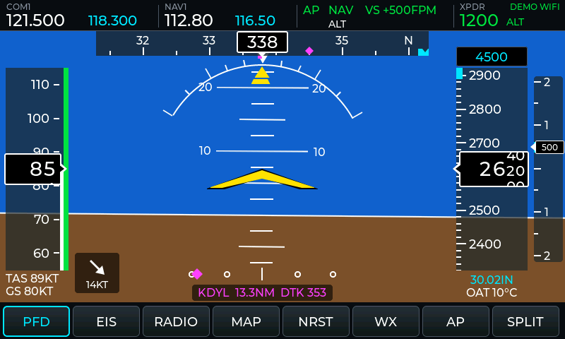
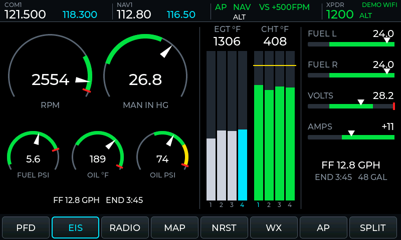
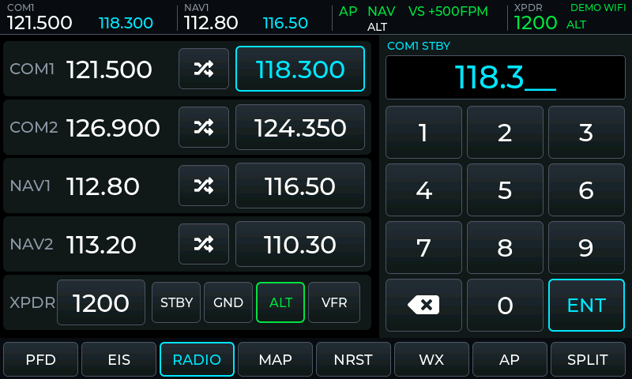
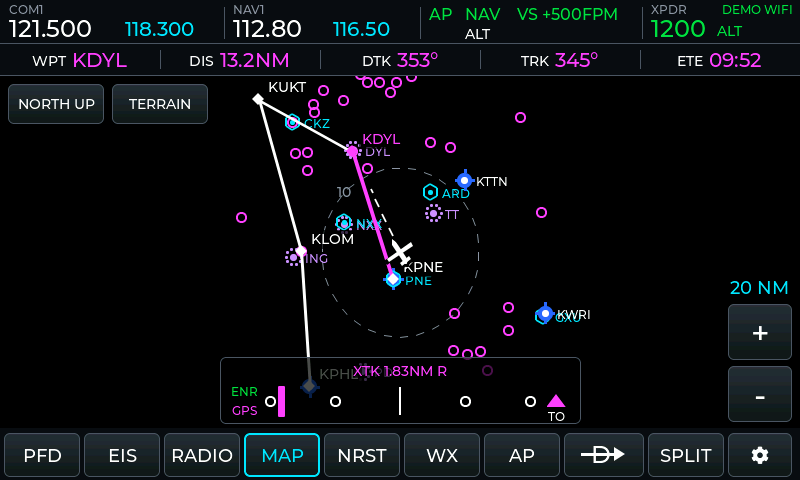
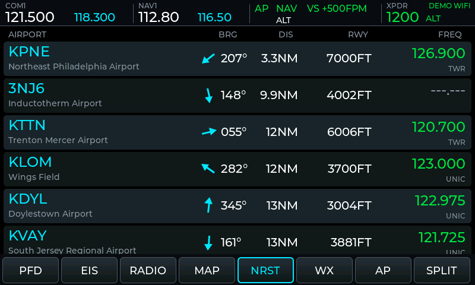
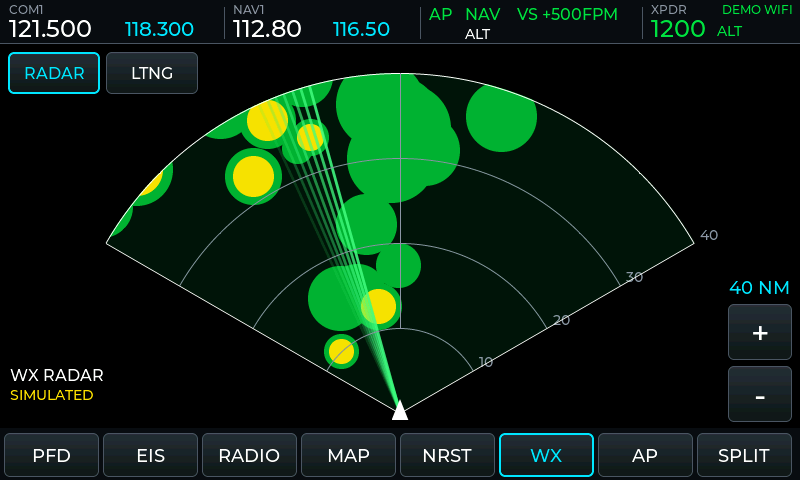
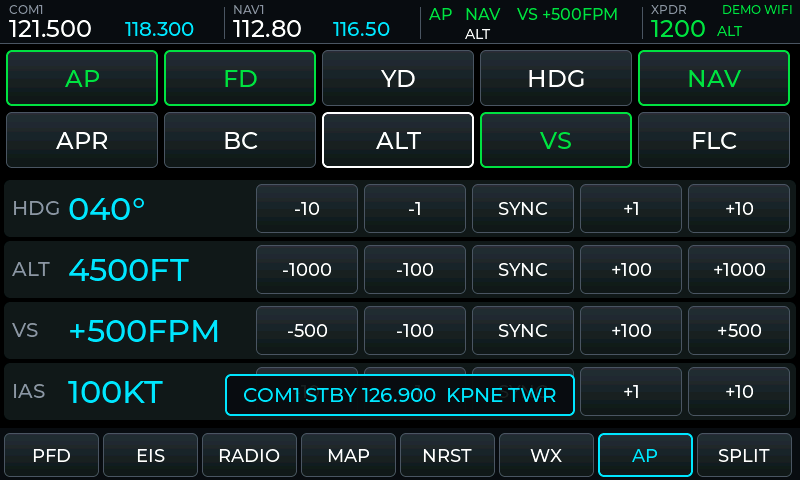
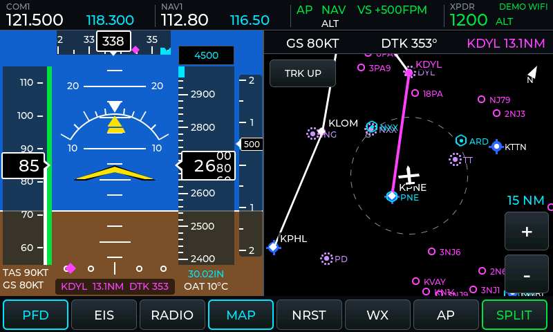
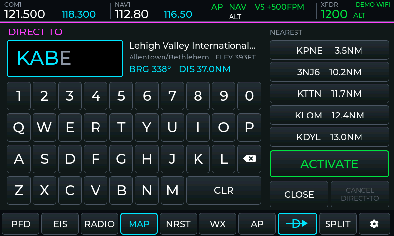
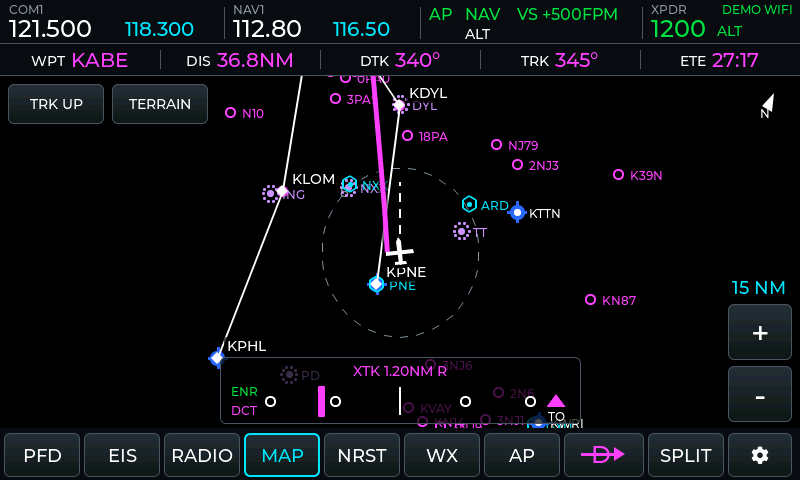

# ESP32-S3 7" Flight Sim MFD

A standalone, Garmin G3X-style multi-function display for **MSFS 2024** and **X-Plane 12**, running on the Waveshare ESP32-S3-Touch-LCD-7 (800×480, capacitive touch). A small Python bridge on the sim PC streams telemetry to it over WiFi (WebSocket) or USB serial. Radio, transponder and autopilot changes made on the touchscreen are sent back into the simulator.

> **For flight simulation only.** This is not certified avionics: never use it for real-world flight or navigation. Use it at your own risk; it comes with no warranty. Open source under the [MIT License](LICENSE).

**Download:** the latest MFD-Bridge-Setup installer is on the [Releases page](https://github.com/thedaviator/mfd-flightsim/releases). Questions and bug reports: [Issues](https://github.com/thedaviator/mfd-flightsim/issues).

| | |
|---|---|
|  |  |
|  |  |
|  |  |
|  |  |
|  |  |

The screenshots come from `tools/ui_preview`, which runs the firmware's own UI code on a PC and feeds it a recording of the bridge's demo flight.

## For end users

End users don't need anything from this repository except the release files. For them, see [docs/QUICKSTART.html](docs/QUICKSTART.html):

1. Run **MFD-Bridge-Setup.exe** on the sim PC. Python and every library are built into the app. Setup refuses anything older than 64-bit Windows 10 1809. It installs the Microsoft Visual C++ runtime if it's missing (bundled, works offline), detects MSFS 2020/2024 and X-Plane 12, adds the firewall rule, can start the app with Windows, and upgrades an older version in place.
2. Power the display from its **USB** port and pick a WiFi network on its Settings page (on-screen keyboard).
3. Fly. The display finds the PC automatically.

Firmware updates go **over WiFi**: MFD Bridge offers its bundled firmware (HTTP, port 8082, MD5-checked), and the display shows an **INSTALL** button on its Settings page. It writes the update to the second OTA slot and switches over only once the image has been verified. For a first install or recovery, use **Update display over USB…** in the app or the browser installer in `release/webflash/`.

### Building a release

```bash
pip install pyinstaller esptool pillow
```

```bash
python tools/make_release.py
```

This needs Inno Setup 6 (`winget install JRSoftware.InnoSetup`). It produces:

| Output | What it is |
|---|---|
| `release/MFD-Bridge-Setup-<version>.exe` | Installer: the bridge app (Python built in), display firmware, airport database, Quick Start guide, firewall rule, optional autostart |
| `release/webflash/` | Browser firmware installer (ESP Web Tools). Host it on any https site, e.g. GitHub Pages; it also works from `localhost`. |
| `release/firmware/` | The four flash parts and `parts.json` (their offsets). They are written separately, so the display keeps its WiFi settings. |

The app version is `APP_VERSION` in `bridge/mfd_bridge_app.py`. The firmware version is `FW_VERSION` in `src/config.h`.

## Status

- The bridge runs. In demo mode a WebSocket client receives 30 packets/s (about 23 KB/s), and frequency, swap, squawk and autopilot commands take effect.
- The firmware compiles for the board (860 KB flash, 50 KB static RAM).
- All pages, full screen and split, render in the PC preview. The preview's touch script confirms that each touch flow sends the right command.
- **Verified on the board (Waveshare Rev1.2):** USB flashing, WiFi setup, the bridge link with the demo flight and MSFS 2024, firmware updates over WiFi, and a stable picture. Stability needs Arduino-ESP32 3.x with RGB bounce buffers and the core settings in `platformio.ini`.
- **Not yet verified on hardware:** touch accuracy, WiFi/WebSocket and the Settings page on the real board, frame rate, and both live simulators.
- **Board quirk:** with the cable in the **UART1** port, the USB-serial chip holds the ESP32 in download mode at reset, so the display stays dark. Run the display from the **USB** port; UART1 is only for flashing. That makes the USB serial link (`--serial`) a developer option on this board.

## Screens

The top bar always shows COM1 and NAV1 (active and standby), the autopilot modes (active in green, armed in white), the transponder code and mode, and the link status. The bottom softkeys select the pages, grouped by task: `PFD · MAP · NRST · WX · RADIO · AP · EIS · D→ · SPLIT · ⚙`. **SPLIT** puts the PFD on the left and the selected page on the right.

| Page | What it shows | Touch |
|---|---|---|
| **PFD** | Attitude with pitch ladder and roll scale. Slip/skid indicator. Airspeed and altitude tapes with rolling digits and V-speed colour bands. VSI. Heading tape with heading bug, track and turn trend. Selected altitude, baro, TAS/GS, wind, OAT, active waypoint with CDI. `PARK BRAKE` annunciation: yellow while set and stopped or taxiing, red and flashing when set above 10 kt or in the air. | — |
| **MAP** | Aircraft-centred moving map: flight plan (active leg magenta), airports, VORs and NDBs. Nav data strip `WPT DIS DTK TRK ETE`, track vector, and a CDI with XTK whenever there is a course. | + / − range (1–200 nm), NORTH UP / TRK UP. |
| **NRST** | Nearest 25 airports: ident, name, bearing (with a pointer relative to the nose), distance, longest runway, tower or CTAF frequency. | Tap an airport to put its frequency in COM1 standby. |
| **WX** | RADAR: 120° heading-up sector with an animated sweep and precipitation cells. LTNG: 360° stormscope with strikes ageing over 2 minutes. | RADAR / LTNG, + / − range. |
| **RADIO** | COM1, COM2, NAV1 and NAV2, active and standby. Transponder code and mode. | Tap a standby frequency or the squawk, then type on the keypad and press ENT. ⇄ swaps. STBY / GND / ALT, VFR. Frequencies all start with 1, so typing `183` gives 118.3. Tap the NAV1 or NAV2 name to choose which one the top bar shows (for aircraft with only NAV2, such as the vFlyteAir Cherokee 140 with its original panel). |
| **AP** | Mode keys AP, FD, YD, HDG, NAV, APR, BC, ALT, VS, FLC. Heading, altitude, VS and IAS selectors. | Selector keys repeat while held. SYNC sets the present value. |
| **EIS** | Arc gauges: RPM, manifold pressure, fuel pressure, oil temperature, oil pressure. CHT and EGT bars per cylinder. Linear gauges: fuel L/R, volts, amps. Fuel flow and endurance. | — |

### Direct-To (D→ softkey)

The **D→** softkey opens the Direct-To window over the page. Type an airport ident on its keyboard. Every key asks the bridge's airport database, which fills in the rest of the ident (type `KAB` and it offers `KABE`) and shows the name, city, elevation, bearing and distance. IATA and FAA codes work too (`ABE`, `PHL`, `N51`). Or tap one of the five nearest airports. **ACTIVATE** starts a course from the present position to the airport.

While it is active, the display computes the guidance itself, 10 times a second, from the aircraft's position, ground track and ground speed (`src/nav_dct.cpp`, great-circle math in double precision):

| | |
|---|---|
| DIS | Great-circle distance to the airport, nm |
| DTK | Desired track at the point abeam the aircraft, magnetic. It follows the great circle, so it changes along long legs. |
| TRK | Ground track from the simulator, magnetic |
| ETE | DIS / ground speed (above 30 kt) |
| XTK | Distance off the course, nm, R or L |
| TO / FROM | FROM once the aircraft is abeam or past the airport |

The Direct-To replaces the simulator's active waypoint on every page: the PFD's waypoint line and CDI, and the map's data strip. The map draws the course as a magenta line along the great circle from where ACTIVATE was pressed. If the aircraft drifts off it, the line stays where the course really is, so the pilot can see which way to turn to intercept, helped by the dashed track vector. The CDI's full scale is 2 nm (ENR), or 1 nm (TERM) within 30 nm of the airport. **ARRIVING** shows 1 nm out. Press **D→** again to restart the course from the present position (ACTIVATE) or to **CANCEL DIRECT-TO**. D→ or any page key closes the window.

The Direct-To lives on the display. It is not sent to the simulator's GPS or autopilot (there are no standard SimConnect or X-Plane commands for that), and it does not survive a restart of the display.

Top bar shortcuts:

- Tap COM or NAV to open the radio page on that field. Long-press to swap active and standby. The NAV box shows NAV1 or NAV2, as chosen on the RADIO page; the display remembers the choice.
- Tap the autopilot box to open the AP page.
- Tap XPDR to enter a squawk. Long-press XPDR for the system status window (WiFi, link, packet counts, frame rate, free memory).

## Quick start

### 1. The bridge (sim PC)

Install Python 3.11 or newer, then:

```bash
pip install -r bridge/requirements.txt
```

```bash
python bridge/mfd_bridge.py
```

The bridge detects MSFS or X-Plane automatically. On first start it downloads the OurAirports database (about 20 MB) into `bridge/data/`. Allow Python through the Windows firewall when asked (TCP 8080 for the WebSocket, UDP 8081 for the discovery beacon).

To test without a simulator, run the built-in demo flight. It responds to every control on the display:

```bash
python bridge/mfd_bridge.py --sim demo
```

| Option | Meaning |
|---|---|
| `--sim auto\|msfs\|xplane\|demo` | Data source (default `auto`) |
| `--serial COM5` | Also send over USB serial (921,600 baud) |
| `--no-ws` | Serial only |
| `--port 8080` | WebSocket port |
| `--xp-host 192.168.1.20` | X-Plane on another PC |
| `--plan route.pln` | Show this flight plan on the map (MSFS `.pln` or X-Plane `.fms`) |
| `--wx live\|synthetic\|off` | WX page: real radar and lightning from the internet (default), generated storms, or nothing |
| `--no-metar` | No METARs on the NEAREST page |
| `--min-rwy 2500` | NEAREST: shortest runway to list, in feet |
| `-v` | Log commands, display log lines (serial) and throughput |

### 2. The firmware (display)

1. Install PlatformIO (VS Code extension, or `pip install platformio`).
2. WiFi is set on the display's **Settings page** (gear key) and saved in its flash. So is **SCREEN SLEEP** (OFF / 5 / 10 / 30 min, default 10): with no flight data and no touch for that long, the screen dims for 30 s and then the backlight goes off (it has no brightness control). Flight data or a touch wakes it; the waking touch is not passed on. `src/secrets.h` (copied from `secrets.h.example`) is optional and only supplies first-boot defaults.
3. Slide the switch next to BOOT to **UART1**, connect the **UART1** USB-C port, hold BOOT, tap RESET, release BOOT, and flash:

   ```bash
   python -m platformio run -t upload
   ```

   Then move the cable to the **USB** port to run it. If the upload can't connect, check the UART1 switch, and close 3D-printer slicers (Cura and others): they grab every COM port.

The display shows **NO FLIGHT DATA** until the bridge is sending. The top-right corner tells you which part is missing: `NO WIFI`, `NO BRIDGE`, `NO SIM`, or the source and link (`MSFS WIFI`, `XPLANE USB`, `DEMO WIFI`).

### USB serial instead of WiFi

Keep the UART port connected and run:

```bash
python bridge/mfd_bridge.py --serial COM18
```

Use the COM port Windows assigned to the board's CH343. The display uses whichever link is delivering data. Its log lines share the serial port; the bridge ignores them, or prints them with `-v`.

## Simulator notes

| | MSFS 2024 (SimConnect) | X-Plane 12 (UDP) |
|---|---|---|
| Reading | One SimConnect data definition with every SimVar, streamed once per visual frame | RREF subscription at 30 Hz |
| Radios | `COM_STBY_RADIO_SET_HZ`, `NAV1_STBY_SET_HZ` …, swap events | DREF writes to `com1_standby_frequency_hz_833` …, `sim/radios/*_standy_flip` |
| Transponder | `XPNDR_SET` (BCD), `TRANSPONDER STATE` | DREF `transponder_code` / `transponder_mode` |
| Autopilot | `AP_MASTER`, `AP_PANEL_HEADING_HOLD`, `HEADING_BUG_SET`, `AP_ALT_VAR_SET_ENGLISH` … | `sim/autopilot/*` commands, `*_dial_*` datarefs |

Limitations:

- **Per-cylinder temperatures:** both sims give one CHT and one EGT per engine. The bridge spreads them over four bars with a small fixed offset pattern, so the differences between cylinders are cosmetic.
- **Weather:** neither sim exposes radar returns or lightning to add-ons, so the bridge fetches real-world weather (`--wx live`, the default; needs internet on the sim PC):
  - **Radar:** the [RainViewer](https://www.rainviewer.com/api.html) mosaic, worldwide wherever there are weather radars, updated every 10 minutes, about 0.6 nm per pixel (the free API's zoom limit). The bridge converts its colours back to dBZ and sends levels: green from 20 dBZ, yellow 30, red 40, magenta 50. The page shows the frame's age (`RAINVIEWER 6 MIN`).
  - **Lightning:** NOAA GOES-19 / GOES-18 Geostationary Lightning Mapper flashes from the public AWS buckets, new every 20 s, 30-60 s behind real time. Coverage is the Americas and the nearby oceans; elsewhere the page shows `NO GLM COVERAGE`. Strikes stay on the stormscope for 3 minutes.

  This matches the sim's sky only when the sim uses live weather. With preset weather, or offline, use `--wx synthetic`: storm cells generated around the aircraft that drift with the sim's wind, labelled **SIMULATED**. `--wx off` turns the page's data off.
- **Terrain (MAP page):** from a microSD card in the display's TF slot. MFD Bridge's **Terrain SD card...** button (or `python bridge/terrain_sd.py E:`) fills an 8-32 GB FAT32 card with the free AWS Terrain Tiles: the whole world at about 1 km and the US (lower 48, Alaska, Hawaii, Puerto Rico) at about 120 m, roughly 4 GB, about 15-45 minutes (mostly the card's write speed), resumable. The **TERRAIN** key on the MAP page cycles **TOPO** (colours by height) and **REL ALT** (red: terrain within 100 ft below the aircraft or higher; yellow: within 1000 ft below). Elevation data: Mapzen/AWS Terrain Tiles (SRTM, GMTED2010, ETOPO1, USGS 3DEP and others). Not for navigation.
- **METARs:** the NEAREST page shows the current METAR and flight category (VFR, MVFR, IFR, LIFR) of each airport that reports one, from [aviationweather.gov](https://aviationweather.gov/data/api/) (worldwide). They are refreshed every 10 minutes. `--no-metar` turns them off.
- **Transponder GND:** MSFS has no ground mode. GND is sent as ON, and the display keeps showing GND.
- **Aircraft-specific systems:** some MSFS aircraft (G1000 NXi, G3000, third-party) use their own L:vars or H:events for radios and the autopilot instead of the standard events. The standard events work for most default general-aviation aircraft.
- **Flight plan:** the sims export only the active leg. Pass the full route with `--plan`.

## Packet format

Bridge to display: one JSON object per WebSocket text frame, or per line on serial. Every packet is a partial update: the display merges whichever sections are present.

| Section | Rate | Contents |
|---|---|---|
| `pfd` | 30 Hz | `pitch roll ias tas gs alt agl hdg trk vsi slip turn baro oat` |
| `nav` | 30 Hz | `lat lon magvar wind_dir wind_spd`, plus active waypoint `to to_dist to_brg dtk xtk ete` |
| `eis` | 10 Hz | `rpm mrp ff oil_t oil_p fuel_p cht[] egt[] fuel_l fuel_r fuel_cap volts amps` |
| `rad` | 10 Hz | `com1_act com1_stby com2_act com2_stby nav1_act nav1_stby nav2_act nav2_stby xpdr xpdr_mode` (strings) |
| `ap` | 10 Hz | `master fd yd lat lat_arm vert vert_arm hdg alt vs ias` |
| `nrst` | 1 Hz | `[{icao name dist brg rwy freq ftype elev metar cat}]` (`metar` without the identifier and remarks, `cat` VFR MVFR IFR LIFR; both only when there is a report) |
| `map` | 1 Hz | `fpl: [[id,lat,lon]]`, `act` (active waypoint index), `pts: [[kind,id,lat,lon]]` (kind V, N, A, or a for a small airport) |
| `wx` | 1 Hz, own packet | `grid: {lat lon nm n rle}`: radar levels on an n × n north-up grid centred on (lat, lon), ±nm wide, row by row from the north-west corner, run-length coded as a level character (`.gyrm` = 0–4) followed by the run length when it is over 1; `strikes: [[lat,lon,age]]`; `rdr_txt rdr_ok ltg_txt ltg_ok`: status lines for the page (`ok` 0 shows it as a caution) |
| `apt` | on request | answer to `apt_find`: `q` (the query) and `list: [[ident,name,city,lat,lon,elev]]`, at most 6, best first |
| `src` | every packet | `MSFS`, `XPLANE`, `DEMO`, or `NONE` (bridge up, no sim) |

```json
{"src":"MSFS","pfd":{"pitch":2.5,"roll":-1.2,"ias":125,"alt":4500,"hdg":180,"vsi":500},
 "eis":{"rpm":2400,"mrp":23.5,"cht":[380,385,390,382],"egt":[1350,1360,1355,1348],"fuel_l":18.5,"fuel_r":19.0},
 "rad":{"com1_act":"121.500","com1_stby":"118.300","xpdr":"1200"},
 "nrst":[{"icao":"KPHL","dist":12.4,"brg":45,"freq":"118.500"}]}
```

Display to bridge: commands as JSON, in the same frames or lines.

```json
{"cmd":"freq","radio":"com1","mhz":118.300}      // set standby: com1 com2 nav1 nav2
{"cmd":"wx_range","nm":40}                        // weather radar range: the bridge sizes the grid to it
{"cmd":"swap","radio":"nav1"}
{"cmd":"xpdr","code":"7000"}
{"cmd":"xpdr_mode","mode":"ALT"}                // STBY GND ON ALT
{"cmd":"ap","key":"HDG"}                        // AP FD YD HDG NAV APR BC ALT VS FLC (toggles)
{"cmd":"ap_set","var":"alt","val":6500}         // hdg alt vs ias
{"cmd":"map_range","nm":28}                     // map symbol radius the display needs
{"cmd":"apt_find","q":"KAB"}                    // Direct-To lookup: exact ident first, then IATA/FAA codes and prefixes, nearest first
```

## Customising

- **Aircraft limits** (V-speeds, engine gauge ranges, tank size): the bottom of [src/config.h](src/config.h).
- **Pins and panel timing:** [src/config.h](src/config.h).
- **Colours and fonts:** [src/ui_priv.h](src/ui_priv.h).

## Previewing the UI on a PC

```bash
pip install ziglang pillow
```

```bash
python tools/ui_preview/preview.py
```

This records 60 seconds of the bridge's demo flight, then compiles the UI with LVGL for the PC and plays the recording into it. It taps through the touch flows and checks every command the display sends. PNGs go to `tools/ui_preview/out/`. Run `python -m platformio pkg install` once first to download LVGL and ArduinoJson.

## Architecture

```
 sim PC                                            display (ESP32-S3)
 ┌──────────────────────────────┐                  ┌──────────────────────────────────────┐
 │ MSFS ── Python-SimConnect ─┐ │   WebSocket :8080│ core 0: net task                     │
 │ X-Plane ── UDP RREF/DREF ──┼─┼──────────────────┼─▶ WiFi, beacon, WS client, serial ──┐ │
 │ demo flight ───────────────┘ │   or USB 921600  │                    telemetry_ingest ▼ │
 │   mfd_bridge.py              │◀─────────────────┼── command queue ◀── UI    [mutex]     │
 │   navdb (OurAirports)        │   commands       │ core 1: LVGL 8.4, 7 pages, split view│
 │   weather, METARs (internet) │                  │   RGB panel (PSRAM FB) · GT911 touch │
 └──────────────────────────────┘                  └──────────────────────────────────────┘
```

```
bridge/
  mfd_bridge_app.py    Windows app: status, settings, autostart, firmware updater
  mfd_bridge.py        main loop, packet builder, WebSocket / serial / beacon (also a CLI)
  sim_msfs.py          MSFS via Python-SimConnect (bulk data definition, events)
  sim_xplane.py        X-Plane 12 via UDP RREF / DREF / CMND
  sim_demo.py          demo flight that follows the display's commands
  navdb.py             OurAirports airports, runways, frequencies, navaids; .pln/.fms reader
  wx.py                WX page data: RainViewer radar, GOES lightning, or synthetic storms
  metar.py             METARs for the NEAREST page (aviationweather.gov)
  terrain_sd.py        terrain SD card builder (AWS Terrain Tiles -> TERRAIN/<z>/<x>/<y>.BIN)
  simstate.py          the simulator-independent state and command list
src/
  main.cpp             setup, UI loop (core 1)
  board.*              RGB panel (esp_lcd), GT911, CH422G expander, LVGL drivers
  link.*               WiFi, UDP discovery, WebSocket client, serial reader (core 0)
  telemetry.*          data model, JSON parser, command builders (portable)
  ui_shell.cpp         top bar, softkeys, split screen, toasts, status window
  ui_setup.cpp         Settings page: WiFi scan, on-screen keyboard, bridge address, screen sleep
  ui_splash.cpp        boot splash (3 s, with the firmware version)
  terrain.*            terrain tiles from the SD card: PSRAM cache, loader task, sampling
  ui_pfd/eis/radio/map/nrst/wx/ap.cpp   the seven pages
  ui_dct.cpp           Direct-To window: ident entry, nearest picks, ACTIVATE / CANCEL
  nav_dct.*            Direct-To guidance: great-circle DIS, DTK, XTK, ETE, TO/FROM (portable)
  ui_common.cpp        widget and drawing helpers
tools/ui_preview/      PC renderer and touch-flow script
tools/make_branding.py AeroRelics artwork -> boot splash (src/splash_img.cpp), app icon/banner, setup images
branding/              AeroRelics artwork (splash, setup welcome page, logo banner)
tools/make_release.py  builds the installer, firmware image and web flasher
installer/             Inno Setup script
webflash/              browser firmware installer page
docs/QUICKSTART.html   end-user guide (shipped with the installer)
```

## Performance notes

The PFD is a single custom-drawn LVGL object. The sky and ground are filled straight into the draw buffer one span per row, so the full-screen fill takes about a millisecond. Tapes, ladder and symbols use LVGL's anti-aliased primitives. The PFD redraws on every attitude packet (30 Hz), the map at up to 15 Hz, the radar sweep at 20 Hz, and the other pages only when their data changes. LVGL renders 60-line strips in internal RAM, which are copied into the PSRAM frame buffer.

The long-press status window shows the measured frame rate. If the picture shifts sideways under WiFi load (the LCD DMA and the CPU share PSRAM bandwidth), lower `LCD_PCLK_HZ` in `config.h`.

## License

Copyright (c) 2026 AeroRelics - David Eckert. The firmware, MFD Bridge, tools and documentation are free, open-source software under the [MIT License](LICENSE): use, copy, modify and share them, keeping the copyright notice. The software is provided "as is", without warranty of any kind. You use it, and flash it onto your hardware, at your own risk.

It builds on open-source components and public data that keep their own licenses, listed in [THIRD_PARTY_NOTICES.txt](THIRD_PARTY_NOTICES.txt). Two of them are copyleft: the bridge bundles Python-SimConnect (AGPL-3.0) and esptool (GPL-2.0-or-later), and the firmware links the Arduino core and arduinoWebSockets (LGPL-2.1). Their source is available from their project pages.

The installer shows the "use at your own risk" terms ([installer/LICENSE_AGREEMENT.txt](installer/LICENSE_AGREEMENT.txt)) and continues only once they are accepted.

Not affiliated with, endorsed by or supported by Microsoft, Laminar Research, Garmin, Avidyne or Waveshare. All trademarks belong to their owners.
